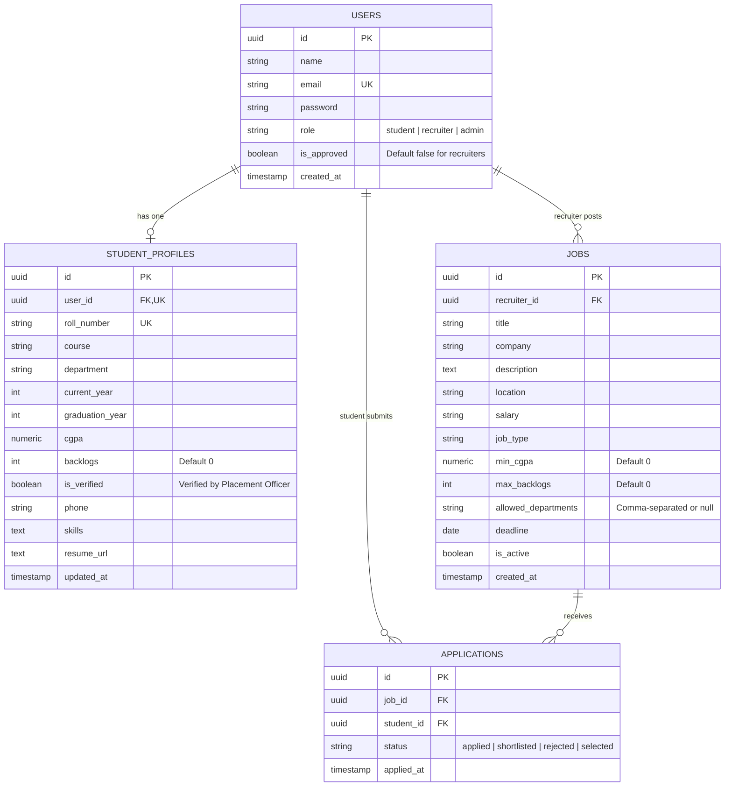

# 🎓 College Placement & Recruitment Portal - Backend API

A complete, beginner-friendly RESTful backend API built with **Node.js**, **Express.js**, and **Supabase (PostgreSQL)** for managing on-campus recruitment drives in a college.

Companies visit the college to recruit students, the **College Placement Officer (Admin)** manages and oversees the drives, and students apply based on transparent eligibility criteria (CGPA, backlogs, department).

---

## 📋 Table of Contents
1. [Core Roles & Workflow](#-core-roles--workflow)
2. [Tech Stack](#-tech-stack)
3. [Project Structure](#-project-structure)
4. [Database Schema & Update Script](#-database-schema--update-script)
5. [Placement Business Logic & Policies](#-placement-business-logic--policies)
6. [Step-by-Step Setup Guide](#-step-by-step-setup-guide)
7. [API Endpoints Reference](#-api-endpoints-reference)
8. [Sample Request & Response Payloads](#-sample-request--response-payloads)
9. [Full Testing Flow Walkthrough](#-full-testing-flow-walkthrough)
10. [Viva Voce Revision Guide](#-viva-voce-revision-guide)

---

## 👥 Core Roles & Workflow

1. **Student**:
   - Registers account and completes academic profile (roll number, course, department, current year, CGPA, backlogs, skills, resume).
   - Searches and browses active campus recruitment drives.
   - Applies for eligible jobs (must meet CGPA cutoff, backlog limits, and department criteria).
   - Tracks application status (`applied`, `shortlisted`, `rejected`, `selected`).
   - Subject to the **One-Student-One-Offer Policy**: once marked as `selected`, cannot apply to additional jobs.

2. **Company (Recruiter)**:
   - Registers their company profile on the portal (`is_approved = false`).
   - Cannot log in or post jobs until the **Placement Officer approves them** (returns HTTP 403).
   - Once approved, posts campus drives with eligibility criteria (`min_cgpa`, `max_backlogs`, `allowed_departments`).
   - Views applicants for their drives with full academic metrics (roll number, department, CGPA, backlogs).
   - Shortlists candidates and marks final selections.

3. **Placement Officer (Admin)**:
   - Reviews and approves visiting company accounts.
   - Verifies student academic credentials (`is_verified = true`).
   - Views the complete **Campus Placements Report** (`/api/admin/placements`) showing all selected students and hiring companies.
   - Monitors live **Placement Cell Statistics** (`/api/admin/stats`), including total students, verified students, companies, approved companies, jobs, applications, placed students, and placement percentage.
   - Possesses elevated privileges to manage/delete users or cancel job drives.

---

## 🚀 Tech Stack

| Technology | Purpose | Why We Chose It |
| :--- | :--- | :--- |
| **Node.js** | Runtime Environment | High-throughput asynchronous I/O ideal for REST APIs |
| **Express.js** | Web Framework | Lightweight, standard routing and middleware architecture |
| **Supabase (PostgreSQL)** | Cloud Relational Database | Strict relational integrity, foreign keys, cascade deletes, and SQL checks |
| **@supabase/supabase-js** | Database Client | Clean query builder interacting with PostgreSQL via backend Service Role Key |
| **bcryptjs** | Password Hashing | One-way salted hashing (cost factor 10) preventing rainbow table attacks |
| **jsonwebtoken (JWT)** | Stateless Authentication | Cryptographically signed tokens encoding user ID, role, and approval status |
| **cors** | Cross-Origin Middleware | Enables frontend clients (React/Vue/Angular) to connect seamlessly |
| **dotenv** | Environment Variables | Secure configuration loader for database keys and JWT secrets |
| **express-validator** | Request Validation | Sanitizes inputs and ensures required fields, emails, and numeric bounds |
| **nodemon** | Developer Tool | Automatically restarts node server on code edits |

---

## 📁 Project Structure

```text
student_recruitment_website/
├── config/
│   └── supabase.js             # Connects to Supabase with Service Role Key & tests connection
├── controllers/
│   ├── authController.js       # Register, login (with approval checks), and me profile
│   ├── studentController.js    # Academic placement profile fetch and UPSERT
│   ├── jobController.js        # Campus drive listing, recruiter CRUD with eligibility criteria
│   ├── applicationController.js# Eligibility checks, One-Offer policy, apply & status updates
│   └── adminController.js      # Company approvals, student verification, placements & stats
├── routes/
│   ├── authRoutes.js           # /api/auth routes with input validation
│   ├── studentRoutes.js        # /api/students routes (protected: student)
│   ├── jobRoutes.js            # /api/jobs routes (public and approved recruiter)
│   ├── applicationRoutes.js    # /api/applications routes
│   └── adminRoutes.js          # /api/admin routes (protected: admin)
├── middleware/
│   ├── authMiddleware.js       # verifyToken (JWT decoder) & allowRoles (RBAC)
│   └── errorHandler.js         # Input validation checker, 404 handler, and global error catcher
├── database/
│   ├── update.sql              # ALTER statements to update existing databases without data loss
│   └── schema.sql              # Full PostgreSQL schema for fresh setup
├── scripts/
│   └── createAdmin.js          # Utility script to create/seed Placement Officer account
├── .env.example                # Example template of required environment variables
├── .gitignore                  # Prevents node_modules and .env from being committed
├── package.json                # Project dependencies and npm scripts
├── postman_collection.json     # Ready-to-import Postman collection
├── requests.http               # Ready-to-run HTTP requests for VS Code REST Client
├── server.js                   # Application entry point, middleware pipeline, and server listener
└── README.md                   # Complete documentation and viva revision guide
```

---

## 🗄️ Database Schema & Update Script

### If you already have existing tables:
Open and run [`database/update.sql`](file:///c:/Users/peche/student_recruitment_website/database/update.sql) in your **Supabase SQL Editor**:
- Adds `is_approved` to `users`.
- Adds `roll_number`, `course`, `current_year`, `backlogs`, and `is_verified` to `student_profiles`.
- Adds `min_cgpa`, `max_backlogs`, and `allowed_departments` to `jobs`.

### If you are starting fresh:
Open and run [`database/schema.sql`](file:///c:/Users/peche/student_recruitment_website/database/schema.sql) in your **Supabase SQL Editor**.



---

## ⚖️ Placement Business Logic & Policies

1. **Company Recruiter Approval**:
   - Company recruiters self-register with `is_approved = false`.
   - Any attempt to log in before approval returns `403 Forbidden` with a message explaining their account is pending approval by the Placement Officer.
   - Placement Officer approves them via `PUT /api/admin/recruiters/:id/approve`.

2. **Complete Academic Profile Required**:
   - Before applying to any drive, students must have filled out their `roll_number`, `department`, and `cgpa` via `PUT /api/students/profile`.
   - Applying with missing profile fields returns `400 Bad Request`.

3. **Automated Eligibility Checking**:
   When a student applies (`POST /api/applications/:jobId`):
   - **CGPA Check**: Student's CGPA must be `>= job.min_cgpa`.
   - **Backlog Check**: Student's active backlogs must be `<= job.max_backlogs`.
   - **Department Filter**: If `job.allowed_departments` is set, student's department must match one of the allowed departments.
   - If any condition is violated, the API returns `400 Bad Request` with an exact explanation.

4. **One-Student-One-Offer Rule**:
   - If a student's application status is updated to `'selected'` by any company, the system permanently prevents them from submitting further applications to other companies (`400 Bad Request`).

5. **No Duplicate Applications**:
   - Database constraint `UNIQUE(job_id, student_id)` and pre-check in controller prevents students from applying twice to the same job (`409 Conflict`).

---

## ⚙️ Step-by-Step Setup Guide

### 1. Install Dependencies
```bash
npm install
```

### 2. Configure Database in Supabase
1. Open your project on [Supabase](https://supabase.com/dashboard).
2. Go to **SQL Editor** -> Click **New query**.
3. Paste [`database/update.sql`](file:///c:/Users/peche/student_recruitment_website/database/update.sql) (if updating existing tables) OR [`database/schema.sql`](file:///c:/Users/peche/student_recruitment_website/database/schema.sql) (if fresh setup) and click **Run**.

### 3. Configure Environment Variables
Copy [`.env.example`](file:///c:/Users/peche/student_recruitment_website/.env.example) to `.env` and fill in your Supabase credentials:
```env
PORT=5000
SUPABASE_URL=https://your-project-id.supabase.co
SUPABASE_SERVICE_ROLE_KEY=eyJh...your-service-role-key...
JWT_SECRET=super_secret_jwt_key_123456
JWT_EXPIRES_IN=1d
```

### 4. Seed / Verify Placement Officer
Run the seed script to create or update the Placement Officer admin account:
```bash
npm run seed:admin
```
*Default Credentials:*
- **Email:** `admin@portal.com`
- **Password:** `Admin@123`

### 5. Start the Server
```bash
# Development mode with nodemon
npm run dev

# Production mode
npm start
```

---

## 📡 API Endpoints Reference

All endpoints return uniform JSON:
```json
{
  "success": true,
  "message": "Descriptive message here",
  "data": { ... }
}
```

### 1. Authentication (`/api/auth`)
| Method | Endpoint | Access | Description |
| :--- | :--- | :--- | :--- |
| `POST` | `/api/auth/register` | Public | Register Student (auto-approved) or Company (pending approval) |
| `POST` | `/api/auth/login` | Public | Log in and receive JWT (blocked if recruiter unapproved) |
| `GET` | `/api/auth/me` | Protected | Fetch current authenticated user and profile |

### 2. Placement Officer Administration (`/api/admin`)
| Method | Endpoint | Access | Description |
| :--- | :--- | :--- | :--- |
| `GET` | `/api/admin/recruiters/pending` | Admin | View companies awaiting approval |
| `PUT` | `/api/admin/recruiters/:id/approve` | Admin | Approve a visiting company |
| `PUT` | `/api/admin/students/:id/verify` | Admin | Verify student academic credentials |
| `GET` | `/api/admin/placements` | Admin | View all placed students, jobs, and companies |
| `GET` | `/api/admin/stats` | Admin | View live placement statistics and placement percentage |
| `GET` | `/api/admin/users` | Admin | View all users with optional `?role=` |
| `DELETE` | `/api/admin/users/:id` | Admin | Delete a user account |

### 3. Student Profile (`/api/students`)
| Method | Endpoint | Access | Description |
| :--- | :--- | :--- | :--- |
| `GET` | `/api/students/profile` | Student | View current academic placement profile |
| `PUT` | `/api/students/profile` | Student | Update profile (roll number, department, CGPA, backlogs, etc.) |

### 4. Campus Drives & Jobs (`/api/jobs`)
| Method | Endpoint | Access | Description |
| :--- | :--- | :--- | :--- |
| `GET` | `/api/jobs` | Public | View active campus drives (supports search & filter) |
| `GET` | `/api/jobs/my/list` | Recruiter | View drives posted by the logged-in company |
| `GET` | `/api/jobs/:id` | Public | View detailed job criteria |
| `POST` | `/api/jobs` | Recruiter | Post new campus drive with eligibility criteria |
| `PUT` | `/api/jobs/:id` | Recruiter | Update own campus drive criteria |
| `DELETE` | `/api/jobs/:id` | Recruiter/Admin | Delete own job (recruiter) or any job (admin) |

### 5. Applications & Placement Tracking (`/api/applications`)
| Method | Endpoint | Access | Description |
| :--- | :--- | :--- | :--- |
| `POST` | `/api/applications/:jobId` | Student | Apply to drive (enforces eligibility & One-Offer rule) |
| `GET` | `/api/applications/my` | Student | Track submitted applications and status |
| `GET` | `/api/applications/job/:jobId` | Recruiter | View applicant students with roll number, department, CGPA |
| `PUT` | `/api/applications/:id/status` | Recruiter | Update status: `shortlisted`, `rejected`, `selected` |

---

## 📝 Sample Request & Response Payloads

### 1. Register a Company
`POST /api/auth/register`
```json
{
  "name": "Acme Tech Solutions",
  "email": "hr@acmetech.com",
  "password": "Password@123",
  "role": "recruiter"
}
```
**Response (201 Created):**
```json
{
  "success": true,
  "message": "Company registration submitted successfully. Your account is pending approval by the Placement Officer.",
  "data": {
    "user": {
      "id": "76d4d12c-491a-4d32-b7e1-872f09d3b762",
      "name": "Acme Tech Solutions",
      "email": "hr@acmetech.com",
      "role": "recruiter",
      "is_approved": false,
      "created_at": "2026-10-30T17:00:00.000Z"
    }
  }
}
```

### 2. Complete Student Placement Profile
`PUT /api/students/profile`  
*Header:* `Authorization: Bearer <studentToken>`
```json
{
  "roll_number": "2022CS1042",
  "course": "B.Tech",
  "department": "Computer Science & Engineering",
  "current_year": 4,
  "graduation_year": 2026,
  "cgpa": 8.75,
  "backlogs": 0,
  "phone": "+91-9876543210",
  "skills": "Java, Python, Node.js, Express, PostgreSQL, Git",
  "resume_url": "https://example.com/resumes/rahul-sharma.pdf"
}
```

### 3. Post a Campus Drive with Eligibility Criteria
`POST /api/jobs`  
*Header:* `Authorization: Bearer <recruiterToken>`
```json
{
  "title": "Graduate Software Engineer (Campus Drive)",
  "company": "Acme Tech Solutions",
  "description": "Hiring 2026 graduates with strong problem solving and backend web development skills.",
  "location": "Bangalore / Hybrid",
  "salary": "INR 9,50,000 / year",
  "job_type": "Full-time",
  "deadline": "2026-12-31",
  "min_cgpa": 7.50,
  "max_backlogs": 0,
  "allowed_departments": "Computer Science & Engineering, Information Technology",
  "is_active": true
}
```

### 4. Eligibility Check Rejection (Example)
`POST /api/applications/:jobId`  
*Header:* `Authorization: Bearer <studentToken>`  
**Response (400 Bad Request):**
```json
{
  "success": false,
  "message": "Ineligible: Minimum CGPA required is 7.50, but your CGPA is 7.10.",
  "data": null
}
```

### 5. Get Live Placement Cell Statistics
`GET /api/admin/stats`  
*Header:* `Authorization: Bearer <adminToken>`  
**Response (200 OK):**
```json
{
  "success": true,
  "message": "Placement cell statistics retrieved successfully.",
  "data": {
    "totalStudents": 150,
    "verifiedStudents": 138,
    "totalCompanies": 24,
    "approvedCompanies": 20,
    "totalJobs": 32,
    "totalApplications": 412,
    "placedStudents": 96,
    "placementPercentage": "64.00%"
  }
}
```

---

## 💻 Frontend Web Application (HTML, CSS & Vanilla JS)

The portal features a lightweight, responsive, and beginner-friendly frontend located in the `public/` directory and served statically by Express (`app.use(express.static('public'))`).  
Opening **`http://localhost:5000`** in any web browser loads the portal immediately.

### Frontend Pages:
| Page | Route | Access | Features |
| :--- | :--- | :--- | :--- |
| **`index.html`** | `http://localhost:5000/` | Public | Hero banner, features, search bar, and live campus recruitment drives. |
| **`register.html`** | `/register.html` | Public | Account registration for students & companies with role selection. |
| **`login.html`** | `/login.html` | Public | Role-based redirection and clear 403 pending-approval error handling. |
| **`student.html`** | `/student.html` | Student | **Tabs:** Academic Profile (roll number, CGPA, backlogs), Campus Drives (eligibility check), My Applications. |
| **`company.html`** | `/company.html` | Recruiter | **Tabs:** Post Drive (criteria setup), My Drives (management & delete), Applicants (shortlist & select). |
| **`admin.html`** | `/admin.html` | Admin | **Tabs:** Live Placement Metrics, Pending Companies (Approve button), Student Verification, Placements Report. |

### Shared Frontend Assets:
- **`public/style.css`**: Responsive design system, CSS custom properties, cards, metric tiles, badges, and accessible forms.
- **`public/app.js`**: Shared helper functions for API calls (`apiCall`), JWT storage in `localStorage`, dynamic navbar (`renderNavbar`), route guarding (`checkAuth`), and clean message boxes without `alert()` popups.

---

## 🧪 Full Testing & Browser Demo Walkthrough

### 1. Automated Test Suite (Console)
Run the automated 24-point end-to-end verification suite in terminal:
```bash
npm test
```

### 2. Browser Interactive Demo (Step-by-Step at `http://localhost:5000`)
1. **Open Portal**: Navigate to **`http://localhost:5000`** in your browser.
2. **Register a Company**:
   - Click **Register** (`register.html`).
   - Fill in: Full Name: `"Globex Corp"`, Email: `"hr@globex.com"`, Password: `"Password@123"`, Role: `"Company / Recruiter"`.
   - Click **Create Account**. Note the message: *Company registration submitted. Account is pending approval by the Placement Officer.*
3. **Verify Blocked Login (Approval Gate)**:
   - Go to **Login** (`login.html`) and enter `"hr@globex.com"` / `"Password@123"`.
   - The portal displays a clear warning: `⏳ Account Pending Approval: Your company recruiter account has not been approved by the Placement Officer yet.`
4. **Placement Officer Approves Company**:
   - In `login.html`, log in as Placement Officer: `"admin@portal.com"` / `"Admin@123"`.
   - Redirects to `admin.html`. Open the **Pending Companies** tab.
   - Click **✓ Approve Company** next to Globex Corp.
   - Click **Logout** in top navbar.
5. **Company Posts Campus Drive**:
   - Log in as `"hr@globex.com"` / `"Password@123"`. Redirects to `company.html`.
   - In **Post Campus Drive** tab, enter:
     - Title: `"Associate Software Engineer"`
     - Location: `"Bangalore"`, CTC: `"INR 12,00,000 / year"`
     - Min CGPA: `"7.50"`, Max Backlogs: `"0"`, Branches: `"Computer Science, IT"`
     - Description: `"Hiring backend engineers for cloud microservices."`
   - Click **Publish Campus Drive**. Check the **My Drives** tab to verify the posting.
   - Click **Logout**.
6. **Student Registers & Completes Profile**:
   - Go to `register.html`, register with Name: `"Aarav Patel"`, Email: `"aarav.patel@college.edu"`, Password: `"Password@123"`, Role: `"Student"`.
   - Log in with `"aarav.patel@college.edu"`. Redirects to `student.html`.
   - In **Academic Profile** tab, enter: Roll: `"2022CS3011"`, Course: `"B.Tech"`, Department: `"Computer Science"`, Year: `4`, Graduation: `2026`, CGPA: `8.60`, Backlogs: `0`.
   - Click **Save Academic Profile**.
7. **Student Applies for Drive (Eligibility Verification)**:
   - Click **Campus Drives** tab.
   - Locate the `"Associate Software Engineer"` drive from Globex Corp.
   - Click **Apply for Drive**. The system verifies CGPA (8.60 >= 7.50), backlogs (0 <= 0), and department match.
   - Application succeeds and button changes to **✓ Already Applied**.
   - Check **My Applications** tab to view application with status `"Applied"`.
   - Click **Logout**.
8. **Company Evaluates & Selects Candidate**:
   - Log in as `"hr@globex.com"` / `"Password@123"`. Redirects to `company.html`.
   - Go to **Review Applicants** tab, choose `"Associate Software Engineer"` from dropdown.
   - View Aarav Patel with full academic metrics (Roll Number, Department, CGPA 8.60).
   - Click **Select (Hire)**.
   - Click **Logout**.
9. **Student Confirms Placement Offer (One-Offer Policy)**:
   - Log in as `"aarav.patel@college.edu"`. Redirects to `student.html`.
   - Open **My Applications** tab: see the green **Selected (Placed)** badge and the congratulatory placement banner!
   - Click **Logout**.
10. **Placement Officer Reviews Live Placements & Stats**:
    - Log in as `"admin@portal.com"` / `"Admin@123"`. Redirects to `admin.html`.
    - Check **Placements Report** tab: Aarav Patel is listed with Globex Corp and CTC.
    - Check **Placement Metrics** tab: Placement rate updates to **`100.00%`**!

---

## 🎓 Viva Voce Revision Guide

### 1. How is company recruiter verification enforced in this system?
> **Answer:** Company accounts are created with `is_approved = false` in the PostgreSQL `users` table. During `POST /api/auth/login`, before generating a JWT, the server checks `if (user.role === 'recruiter' && !user.is_approved)`. If unapproved, it returns `403 Forbidden`. Only the Placement Officer can approve them via `PUT /api/admin/recruiters/:id/approve`.

### 2. How are placement eligibility criteria validated?
> **Answer:** In `controllers/applicationController.js`, when a student applies for a job, the backend fetches both the job's eligibility thresholds (`min_cgpa`, `max_backlogs`, `allowed_departments`) and the student's profile from `student_profiles`. It checks:
> 1. Is profile complete?
> 2. `student.cgpa >= job.min_cgpa`
> 3. `student.backlogs <= job.max_backlogs`
> 4. `allowed_departments` contains the student's department.
> If any condition fails, HTTP 400 is returned with the exact rejection reason.

### 3. What is the One-Student-One-Offer rule and how is it implemented?
> **Answer:** To give fair placement opportunities to all students, many colleges adopt a policy where once a student secures a job offer, they cannot apply for further campus drives. This is implemented in `applyForJob` by querying `applications` for any existing row where `student_id = student.id` and `status = 'selected'`. If found, application is blocked with a 400 Bad Request.

### 4. Why is `UNIQUE(job_id, student_id)` important in the applications table?
> **Answer:** It enforces integrity at the database level. Even if a user clicks the "Apply" button multiple times concurrently, PostgreSQL will reject duplicate insertions with a unique constraint violation error, preventing double-application bugs.

### 5. How is placement percentage computed in `/api/admin/stats`?
> **Answer:** The Placement Officer controller executes aggregate `count: 'exact'` queries across `users` (where role is student) and `applications` (where status is selected). The formula is:
> $$\text{Placement Percentage} = \left(\frac{\text{Placed Students}}{\text{Total Registered Students}}\right) \times 100$$
# Apex-College-Placement-Portal

